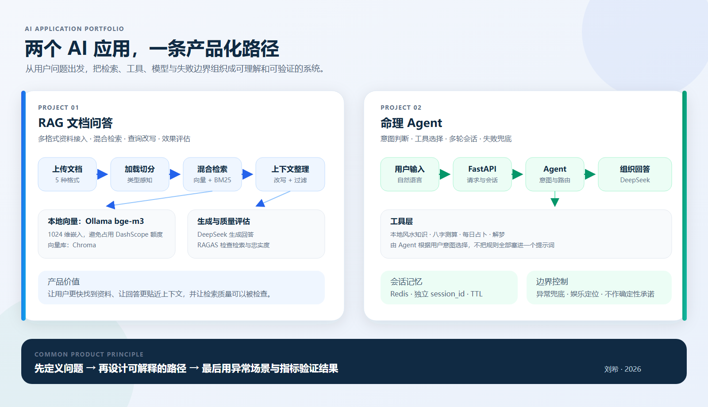
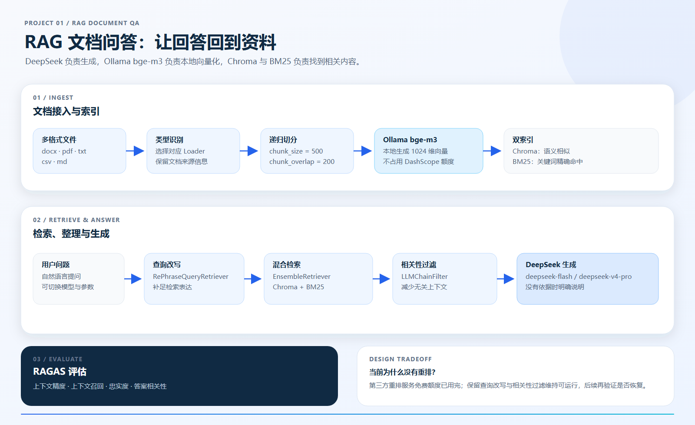
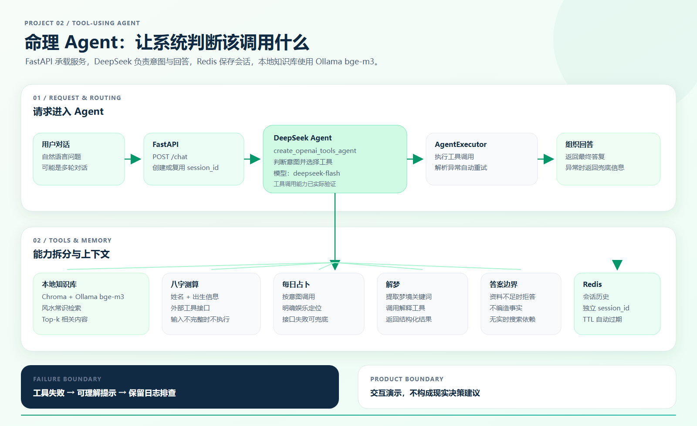

# AI 应用作品集

> 把复杂 AI 能力，转化为用户能理解、能验证、能使用的产品体验。

作者：**刘希**  
方向：全栈开发 · RAG · Agent · 产品理解

本仓库包含两个 AI 应用实践项目的产品说明、系统架构、关键取舍和可运行源码。示例文档、密钥、运行日志与向量数据库不进入仓库。

## 项目一览

| 项目 | 面向的问题 | 核心能力 | 技术关键词 |
| --- | --- | --- | --- |
| [RAG 文档问答](docs/rag-doc-qa.md) | 资料格式多、查找成本高，回答缺少可靠依据 | 多格式文档接入、混合检索、查询改写、过滤、效果评估 | LangChain、Chroma、BM25、bge-m3、RAGAS、Gradio |
| [命理 Agent](docs/agent-numerology.md) | 用户意图分散，单轮问答无法完成任务 | 工具选择、外部服务编排、多轮会话、失败兜底、容器化部署 | FastAPI、LangChain Agent、Redis、Chroma、Docker |

两个项目平均展示。RAG 关注“如何让回答更接近可靠资料”，Agent 关注“如何让系统理解任务并选择合适的工具”。

## 源代码

- [RAG 文档问答源码](rag-doc-qa/)
- [命理 Agent 源码](agent-numerology/)

## 一张图看懂两个项目

[查看架构说明与关键取舍](docs/architecture.md)

## 演示视频

[观看 AI 应用作品集演示视频](https://github.com/Felix-Liu111/ai-application-portfolio/releases/tag/demo-v1)

建议观看顺序：

1. 问题与使用场景
2. RAG 文档问答演示
3. 命理 Agent 演示
4. 架构、取舍与边界说明

## 项目一：RAG 文档问答

### 解决什么问题

企业内部资料往往分散在 Word、PDF、CSV、Markdown 和纯文本中。仅靠关键词搜索，用户需要自己筛选内容；仅靠大模型，回答又可能脱离资料，难以核验。

这个项目把文档接入、内容切分、混合检索、查询改写和回答生成串成一条可观察的问答链路，目标是在资料范围内提供更贴近上下文的回答。

### 系统如何工作

1. 用户上传文档，系统根据文件类型选择加载方式并切分文本。
2. Ollama `bge-m3` 在本地生成向量，与 BM25 共同覆盖语义相似和关键词命中。
3. 查询经过改写与相关性过滤，整理最终上下文。
4. 检索上下文与当前问题一起进入大模型，生成回答。
5. 使用 RAGAS 对上下文精度、召回率、忠实度和答案相关性进行评估。

### 可以重点观察

- 上传不同格式的资料后，问答上下文是否随之变化。
- 同一问题在纯模型问答与知识库问答下有什么差异。
- 查询改写与过滤如何影响最终上下文。
- 资料不足时，系统是否明确说明没有找到答案。

## 项目二：命理 Agent

### 解决什么问题

用户并不会总用规范的方式表达需求。一次对话里可能包含风水、八字、占卜或解梦等不同意图，只靠固定提示词很难给出稳定的响应路径。

这个项目将不同能力封装为工具，由 Agent 根据用户输入选择调用路径，并通过会话记忆保持上下文。

### 系统如何工作

1. FastAPI 接收前端请求，并为每次对话分配会话标识。
2. Agent 根据问题判断应调用本地知识库、八字、占卜还是解梦工具；资料不足时明确说明边界。
3. 工具结果返回 Agent，由模型组织最终回答。
4. Redis 保存会话历史，使多轮对话可以引用前文。
5. 当解析、网络或外部服务失败时，返回可理解的兜底信息。

### 可以重点观察

- Agent 如何把模糊问题路由到不同工具。
- 多轮对话中能否沿用上一轮信息。
- 外部工具不可用时，系统如何避免直接暴露异常。
- 产品为什么需要明确能力边界，而不是把模型输出当成事实承诺。

## 技术能力如何连接产品价值

这两个项目采用同一套产品化思路：

1. **先定义问题**：区分用户是在找资料、完成事务，还是需要多步骤协助。
2. **再设计路径**：把检索、工具调用、记忆和失败处理拆成可解释的环节。
3. **最后验证效果**：用固定问题、异常输入和评估指标检查系统是否真的解决问题。

模型分工采用“云端推理 + 本地检索”：对话模型通过 DeepSeek API 调用，文档向量由本机 Ollama `bge-m3` 生成。这样既保留云端模型的生成能力，也避免把文档向量化绑定到收费接口。

README 中的说明只描述已经实现的系统能力，不引用未经真实测试确认的效果数字。

## 安全与边界

- 公开仓库包含可运行源码、配置模板和展示材料，不包含第三方示例资料、密钥、运行日志或向量数据库。
- 实际运行所需的模型和第三方服务凭据只通过本地环境变量或部署平台的密钥管理能力配置。
- 命理 Agent 的定位是交互演示，不构成医疗、法律、财务或人生决策建议。
- 更多生产化改进项见[安全与限制](docs/security-and-limitations.md)。

## 演示准备

- 模型分工与验证结果：[docs/model-configuration.md](docs/model-configuration.md)

## 使用说明

本仓库内容用于个人求职展示。文档与图片未经授权不得用于商业发布或二次售卖。  
© 2026 刘希。保留所有权利。
